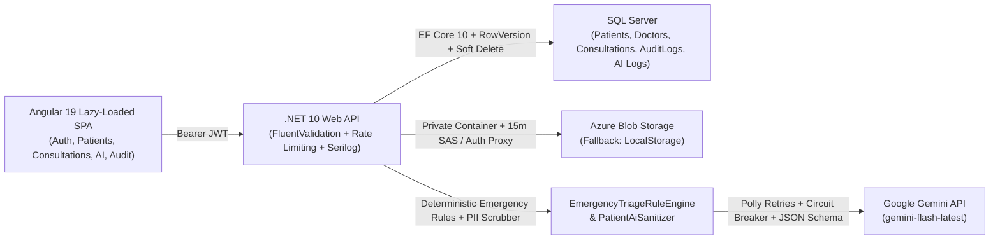

# CareSync — Patient Consultations & Clinical AI Platform

A security-hardened **.NET 10** + **Angular 19** healthcare consultation platform combining Role-Based Access Control (JWT / Azure Entra ID), private Azure Blob Storage, conflict-checked physician scheduling, full audit logging, and a clinical **Google Gemini AI Agent** with rule-based emergency triage and human-in-the-loop action confirmation.

---

## Key Architecture & Security Highlights



### 1. Security & Privacy
- **JWT + Optional Azure AD / Entra ID Authentication:** Roles (`Admin`, `Doctor`, `Receptionist`). Physicians are strictly scoped to their assigned patients (`PrimaryDoctorId`).
- **Server-Side AI Key Management:** No `apiKey` fields exist in API DTOs or browser requests. `Gemini:ApiKey` is loaded exclusively from environment variables or Azure Key Vault.
- **Private Profile Photos:** Containers use `PublicAccessType.None`; clients receive short-lived 15-minute Read SAS URIs (or authenticated `/api/patients/{id}/picture` streaming fallback). Strict 2 MB upload limit and file magic-byte verification (JPEG/PNG/WebP).
- **Safe Onboarding Notifications:** Welcome emails deliver single-use hashed set-password links (`/set-password?token=...`) and never transmit plaintext passwords.
- **Soft Delete & Audit Trail:** Deletions set `IsDeleted`, `DeletedAtUtc`, and `DeletedByUserId` while preserving clinical history. `ApplicationDbContext` records entity mutations to `AuditLogs`. See [COMPLIANCE.md](COMPLIANCE.md) for DPDP Act (2023), HIPAA, and Google Gemini API data-use guidance.
- **Production Controls:** Startup auto-migrations are disabled in production (migrations are packaged separately as idempotent SQL in CI); rate limiting (`auth`, `ai`, and global policies), strict CORS allowlists, and FluentValidation filter active.

### 2. Clinical AI Safety & Quality (`gemini-flash-latest`)
- **Deterministic Emergency Triage (`EmergencyTriageRuleEngine`):** Cardiac chest pain, stroke FAST signs, airway/anaphylaxis, psychiatric crisis, and hemorrhage short-circuit before any LLM invocation to issue immediate emergency instructions (`911` / `112` / `108` / `988`).
- **Prompt Injection Defense & PII Minimization (`PatientAiSanitizer`):** User-written notes/symptoms are delimited inside `<untrusted_clinical_text>` tags; names, emails, phone numbers, and addresses are stripped before calling Gemini; tools execute inside C# authorization checks.
- **Human-in-the-Loop Confirmation:** Scheduling via `propose_consultation` creates a `PendingAiActions` proposal (`Book Dr. Sarah Jenkins...`) requiring an explicit click to `POST /api/ai/actions/{actionId}/confirm`.
- **Structured Output, Citations, Streaming & Simulated Banner:** Enforces Gemini `responseSchema` mapped to validated C# contracts (`ClinicalSummaryResult`, `TriageAssessmentResult`) with single-retry validation recovery, returns consultation `#ID` citations, streams responses over SSE (`/api/ai/chat/stream`) with server-side `AiChatSessions`, logs tokens, latency, cost, and prompt version to `AiInteractionLogs`, and displays an explicit **SIMULATED MODE ACTIVE** banner when running without a live server key.
- **Retrieval-Augmented Generation (RAG):** Clinical PDF/TXT document ingestion via `PdfPig`, text chunking (500-char window, 100-char overlap), 3072-dim vector embeddings with Gemini `gemini-embedding-001` (hash-based pseudo-embeddings are used only when `Rag:AllowPseudoEmbeddings` is enabled, e.g. local development; otherwise indexing fails with HTTP 503 instead of storing meaningless vectors), SQL Server vector store (`PatientDocumentChunks`), patient-scoped hybrid keyword + cosine similarity search (`semantic_search_patient_history`), and automatic chat grounding with document & visit source citations.

### 3. Resilience & Scheduling Reliability
- **Polly Standard Resilience:** `AddStandardResilienceHandler` wraps outbound Gemini calls with exponential backoff retries, timeouts, and circuit breaking.
- **Double-Booking Prevention & Concurrency:** `DoctorsController` exposes slot availability (`/api/doctors/{id}/availability`) and prevents overlapping slots with HTTP `409 Conflict`. `Patient` and `Consultation` carry `[Timestamp] byte[] RowVersion` tokens returning `409 Conflict` on stale updates.
- **Observability:** Serilog structured logging (with optional Application Insights sink), Admin AI usage analytics (`GET /api/ai/usage?from=&to=`), and `/health` + `/health/ready` database health checks.

---

## LLM Foundations

Every outbound AI request records model, prompt/completion/total tokens (summed across multi-step tool-calling loops), latency in milliseconds, estimated USD cost (from `Pricing:<model>:InputPerMillion` / `OutputPerMillion`, verified against Google AI pricing on `2026-11-18`), and the active prompt version (`prompts/summary.v1.txt`, `summary.v2.txt`, `triage.v1.txt`, `chat.v1.txt`). Generation parameters (`Temperature`, `TopP`, `MaxOutputTokens`, `PromptVersion`) are configurable per feature (`Gemini:Features:{Summary,Triage,Chat}`), and an `ILlmClient` abstraction supports both `GeminiLlmClient` and local `OllamaLlmClient` (`Llm:Provider=Ollama`).

### Model Comparison & Cost per Request

Evaluated across 3 task types (**Extraction**, **Summary**, and **Tool Selection** — 4 cases each × 3 runs = **36 runs per model**, scored automatically for valid JSON schema + allowed enums, must-contain clinical terms, zero PII leaks, and exact tool choice). Full report: [docs/model-comparison.md](docs/model-comparison.md).

| Model | Overall Pass Rate | Extraction | Summary | Tool Selection | p50 Latency | p95 Latency | Avg Tokens / Req | Avg Cost / Req (USD) | Total Cost (36 runs) |
| :--- | :---: | :---: | :---: | :---: | :---: | :---: | :---: | :---: | :---: |
| `gemini-flash-lite-latest` | **28/36 (77.8%)** | 10/12 (83%) | 11/12 (92%) | 7/12 (58%) | 4,560 ms | 7,587 ms | 783 | **$0.000119** | $0.004299 |
| `gemini-3.1-flash-lite` | **18/36 (50.0%)** | 12/12 (100%) | 6/12 (50%) | 0/12 (0%)* | 623 ms | 4,191 ms | 270 | **$0.000059** | $0.002131 |
| `gemini-3-flash-preview` | **0/36 (0.0%)**† | 0/12 (0%) | 0/12 (0%) | 0/12 (0%) | 319 ms | 382 ms | 0 | $0.000000 | $0.000000 |

> *Configured per-1M token pricing (`2026-11-18`): Flash-Lite `$0.10` in / `$0.40` out · `gemini-flash-latest` `$0.30` in / `$2.50` out · `gemini-3-flash-preview` `$0.50` in / `$3.00` out · `gemini-pro-latest` `$1.25` in / `$10.00` out. \*`gemini-3.1-flash-lite` hit free-tier RPM limits mid-run after completing 100% of extraction cases. †`gemini-3-flash-preview` returned fast HTTP `429` (graceful simulated fallback) because its free-tier daily quota was exhausted by the preceding 90-run temperature sweep; `gemini-pro-latest` requires a paid tier. CI runs the mocked comparison offline; re-run live with `RUN_LIVE_MODEL_COMPARISON=1 GEMINI_API_KEY=<key> dotnet test --filter Category=ModelComparison`.*

### Temperature Findings (`summary.v1`, 90 Runs)

Tested 10 clinical summary cases (`SUM-24`..`SUM-33`) × 3 runs each at temperatures `0.0`, `0.4`, and `1.0` on `gemini-3-flash-preview` (full breakdown in [docs/summary-temperature-experiment.md](docs/summary-temperature-experiment.md)):

| Temperature | Live Output Behavior | Grounding & PII-Free Checks | Key Takeaway |
| :---: | :--- | :---: | :--- |
| **`0.0`** | Completed live runs (`SUM-24`, `SUM-25`, `SUM-28`, `SUM-29`) achieved **91%–100%** pairwise Jaccard token similarity and **100% (3/3) urgency agreement** before hitting the free-tier RPM cap after 14 calls. | **30/30 (100%)** | Best choice for deterministic clinical summaries and repeatable urgency labels. |
| **`0.4`** | Executed inside the active free-tier `429` rate-limit window (`0/30` live calls); triggered deterministic structured fallback with zero unhandled errors. | **30/30 (100%)** | Safe fallback resilience verified; needs paid-tier quota for full live variance curve. |
| **`1.0`** | Live calls (`SUM-25`, `SUM-26`, `SUM-27`) dropped sharply to **42.9%–49.4%** pairwise Jaccard similarity, and `SUM-26` drifted between `Moderate` and `Routine` urgency across runs. | **30/30 (100%)** | Too unstable for clinical documentation or triage classification. |

### Which Model for Which Task

For **structured extraction and triage**, I would pick **`gemini-3.1-flash-lite`** at `temperature = 0.1`, because it achieved **100% extraction accuracy (12/12)** with **623 ms p50 latency** and the lowest cost (**$0.000059/request**), making it ideal for high-volume schema-bound parsing. For **clinical summaries**, I would pick **`gemini-flash-lite-latest`** (or **`gemini-3-flash-preview`** on a paid tier for richer clinical nuance) pinned to **`temperature = 0.0–0.2`**, since it reached **92% summary pass rate (11/12)** at **$0.000119/request** while low temperature preserves **91%–100% output consistency** and eliminates the urgency drift observed at `temperature = 1.0`. For **multi-step tool-calling clinical chat**, I would avoid lite models—which dropped to **58% (7/12)** on tool selection—and route instead to **`gemini-flash-latest` / `gemini-3-flash-preview`** (escalating to **`gemini-pro-latest`** only for complex multi-tool clinical reasoning on a paid tier), where reliable function-calling justifies higher per-token pricing; and for strict zero-egress or air-gapped healthcare deployments, the **`ILlmClient` + `OllamaLlmClient`** backend provides a drop-in local alternative without changing clinical safety or audit pipelines.

---

## Project Structure

```text
├── src/
│   ├── PatientManagement.Core/            # Entities, Enums, Domain Exceptions, DTOs, Interfaces
│   ├── PatientManagement.Infrastructure/  # EF Core 10, Migrations, Auth, AI Safety, Blob & Email Services
│   └── PatientManagement.Api/             # .NET 10 Controllers, JWT/CORS/RateLimit Middleware, Health Checks
├── tests/
│   └── PatientManagement.Tests/           # 114 xUnit Tests (Unit, Integration, RBAC, Concurrency, Mocked AI, RAG, Structured Output, Prompt Versioning & Multi-Model Eval Suite)
├── prompts/                               # Versioned system prompts (summary.v1/v2, triage.v1, chat.v1)
├── docs/                                  # Evaluation reports (model-comparison.md, summary-temperature-experiment.md)
├── frontend/                              # Angular 19 Standalone SPA (Lazy-Loaded Features + Karma Specs)
├── .github/workflows/azure-deploy.yml     # CI/CD: .NET Test+Coverage, EF Script, Angular Lint/Test/Build
├── COMPLIANCE.md                          # DPDP Act, HIPAA & AI Data Governance Guide
├── LICENSE                                # MIT License
└── PatientManagement.slnx                 # .NET Solution File
```

---

## Getting Started (Local Development)

### Prerequisites
- [.NET 10 SDK](https://dotnet.microsoft.com/download/dotnet/10.0)
- [Node.js 20+ / 22+](https://nodejs.org/)
- SQL Server (or LocalDB)

### 1. Run the Backend API
Configure secrets via `dotnet user-secrets` (no production JWT keys, Gemini keys, or seed passwords are stored in tracked config files):

```bash
cd src/PatientManagement.Api
dotnet user-secrets set "Jwt:SigningKey" "<64-char-random-signing-key>"
dotnet user-secrets set "Gemini:ApiKey" "YOUR_SERVER_SIDE_GEMINI_KEY"
dotnet user-secrets set "Seed:AdminPassword" "<dev-admin-password>"
dotnet user-secrets set "Seed:DoctorPassword" "<dev-doctor-password>"
dotnet user-secrets set "Seed:ReceptionistPassword" "<dev-reception-password>"
dotnet run
```

- API / Swagger UI: `http://localhost:5056`
- Health endpoint: `http://localhost:5056/health`

### 2. Run the Angular 19 Frontend
```bash
cd frontend
npm install
npm start
```

- Angular Dev UI: `http://localhost:4200` (configured with `proxy.conf.json` -> `http://localhost:5056`)

### Development Seed Accounts (Development Environment Only)

Passwords are read from `Seed:AdminPassword`, `Seed:DoctorPassword`, and `Seed:ReceptionistPassword` via User Secrets (seeding is skipped outside `Development`):

| Role | Email | Password Secret Key | Permissions |
| :--- | :--- | :--- | :--- |
| **Admin** | `admin@patientportal.com` | `Seed:AdminPassword` | Full access including Audit, AI Interaction Logs & AI Usage Summary |
| **Doctor** | `sarah.jenkins@patientportal.com` | `Seed:DoctorPassword` | Own assigned patients, consultations & AI Assistant |
| **Doctor** | `robert.sterling@patientportal.com` | `Seed:DoctorPassword` | Own assigned patients, consultations & AI Assistant |
| **Receptionist** | `reception@patientportal.com` | `Seed:ReceptionistPassword` | Registration, scheduling & onboarding email logs (no clinical notes/AI/delete) |

---

## Testing & Verification

### Backend (.NET 10 — 114 Automated Tests)
Includes unit tests, InMemory API integration tests (`WebApplicationFactory<Program>`), RBAC & IDOR scoping checks (`401`/`403`), concurrency & double-booking (`409`), upload magic-byte rejection (`400`), Swagger OpenAPI verification, mocked HTTP Gemini tool-calling, token/cost/usage aggregation, structured JSON retry/fallback, prompt versioning, `ILlmClient` (Gemini + Ollama), and a **28-case + multi-model offline AI evaluation suite** (`tests/PatientManagement.Tests/Evaluation/`):

```bash
dotnet test PatientManagement.slnx --collect:"XPlat Code Coverage"
```

### Frontend (Angular 19)
```bash
cd frontend
npm run lint
npm test
npm run build
```

---

## Repository Metadata Suggestions (GitHub)
- **Suggested Description:** `Full-stack .NET 10 + Angular 19 Clinical AI Consultation Platform with JWT RBAC, Private Blob SAS, Soft-Delete Audit Trail, Double-Booking Prevention, and Rule-Safe Gemini AI`
- **Suggested Topics:** `dotnet-10`, `angular-19`, `gemini-ai`, `healthcare`, `jwt-authentication`, `rbac`, `entity-framework-core`, `clean-architecture`, `polly`, `azure-blob-storage`

## License
Released under the [MIT License](LICENSE).
