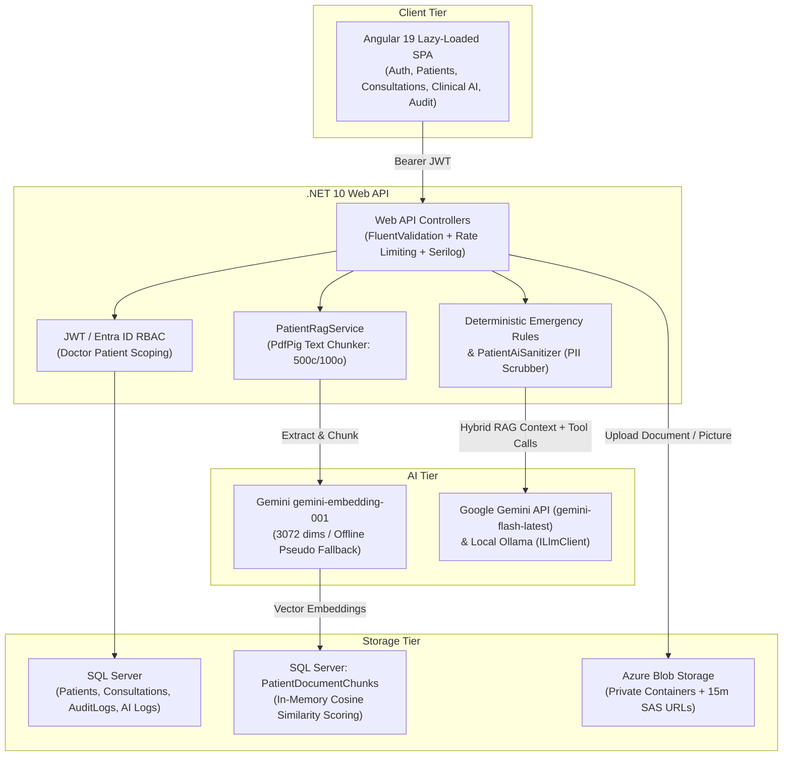

# CareSync — Patient Consultations & Clinical AI Platform

[](https://github.com/kuldipmehta/PatientconsulationswithAI/actions)
[](LICENSE)
[](https://dotnet.microsoft.com/)
[](https://angular.dev/)

> [!CAUTION]
> **Medical Disclaimer & Demonstration Notice:** Decision-support prototype for education and demonstration. Not a medical device. A clinician must review all AI output. All demo patient data is synthetic.

A .NET 10 + Angular 19 healthcare consultation platform with role-based access control (JWT / Azure Entra ID), private Azure Blob storage, conflict-checked scheduling, audit logging, and a Gemini-powered clinical AI agent with rule-based emergency triage, human-in-the-loop action confirmation, and patient-scoped RAG over uploaded reports. Prototype for education and demonstration; not a medical device. All demo data is synthetic.

---

## Key Architecture & Security Highlights



### 1. Security & Privacy
- **JWT + Optional Azure AD / Entra ID Authentication:** Roles (`Admin`, `Doctor`, `Receptionist`). Physicians are strictly scoped to their assigned patients (`PrimaryDoctorId`).
- **Server-Side AI Key Management:** No `apiKey` fields exist in API DTOs or browser requests. `Gemini:ApiKey` is loaded exclusively from environment variables or Azure Key Vault.
- **Private Profile Photos:** Containers use `PublicAccessType.None`; clients receive short-lived 15-minute Read SAS URIs (or authenticated `/api/patients/{id}/picture` streaming fallback). Strict 2 MB upload limit and file magic-byte verification (JPEG/PNG/WebP).
- **Safe Staff Onboarding & Notifications:** Staff account setup (`AppUser`) uses single-use SHA-256 hashed set-password tokens (`PasswordSetupTokens`); patient creation triggers welcome email notifications without transmitting plaintext passwords.
- **Soft Delete & Audit Trail:** Deletions set `IsDeleted`, `DeletedAtUtc`, and `DeletedByUserId` while preserving clinical history. `ApplicationDbContext` records entity mutations to `AuditLogs`. See [COMPLIANCE.md](COMPLIANCE.md) for DPDP Act (2023), HIPAA, and Google Gemini API data-use guidance.
- **Production Controls:** Startup auto-migrations are disabled in production (migrations are packaged separately as idempotent SQL in CI); rate limiting (`auth`, `ai`, and global policies with configurable `ForwardLimit`), strict CORS allowlists, and FluentValidation filter active.

### 2. Clinical AI Safety & Quality (`gemini-flash-latest` / Configurable Models)
- **Deterministic Emergency Triage (`EmergencyTriageRuleEngine`):** Cardiac chest pain, stroke FAST signs, airway/anaphylaxis, psychiatric crisis, and hemorrhage short-circuit before any LLM invocation to issue immediate emergency instructions (`911` / `112` / `108` / `988` Suicide & Crisis Lifeline / `Tele-MANAS 14416`).
- **Prompt Injection Defense & PII Minimization (`PatientAiSanitizer`):** User-written notes/symptoms are delimited inside `<untrusted_clinical_text>` tags; names, emails, phone numbers, and addresses are stripped before calling Gemini; tools execute inside C# authorization checks.
- **Human-in-the-Loop Confirmation:** Scheduling via `propose_consultation` creates a `PendingAiActions` proposal (`Book Dr. Sarah Jenkins...`) requiring an explicit click to `POST /api/ai/actions/{actionId}/confirm`.
- **Structured Output, Citations, Streaming & Simulated Banner:** Enforces Gemini `responseSchema` mapped to validated C# contracts (`ClinicalSummaryResult`, `TriageAssessmentResult`) with single-retry validation recovery, returns consultation `#ID` citations, streams responses over SSE (`/api/ai/chat/stream`) with server-side `AiChatSessions`, logs tokens, latency, cost, and prompt version to `AiInteractionLogs`, and displays an explicit **SIMULATED MODE ACTIVE** banner when running without a live server key.
- **Retrieval-Augmented Generation (RAG):** Clinical PDF/TXT document ingestion via `PdfPig`, text chunking (500-char window, 100-char overlap), 3072-dim vector embeddings with Gemini `gemini-embedding-001` (hash-based pseudo-embeddings are used only when `Rag:AllowPseudoEmbeddings` is enabled, e.g. local development; otherwise indexing fails with HTTP 503 instead of storing meaningless vectors), vectors stored in SQL Server (`PatientDocumentChunks`), scored via brute-force cosine similarity in app memory suited to per-patient scale (no proprietary vector extension required), hybrid whole-word keyword matching, and automatic chat grounding with document & visit citations.
- **Semantic Caching Layer (`ISemanticCacheService`):** Fast-path in-memory vector cache with cosine similarity matching ($\ge 0.93$) and exact string lookup (`MemorySemanticCacheService`). High-confidence paraphrased queries return in $\sim 10$ ms with **\$0.00 cost** and zero tokens consumed. Cache entries are partitioned strictly by patient (`patient:{id}`) and feature scope to prevent cross-patient data leakage, and automatically invalidated whenever patient consultations or clinical documents are created, updated, or re-indexed.

### 3. Resilience & Scheduling Reliability
- **Polly Standard Resilience:** `AddStandardResilienceHandler` wraps outbound Gemini calls with exponential backoff retries, timeouts, and circuit breaking.
- **Double-Booking Prevention & Concurrency:** `DoctorsController` exposes slot availability (`/api/doctors/{id}/availability`) and prevents overlapping slots with HTTP `409 Conflict`. `Patient` and `Consultation` carry `[Timestamp] byte[] RowVersion` tokens returning `409 Conflict` on stale updates.
- **Observability:** Serilog structured logging (with optional Application Insights sink), Admin AI usage analytics (`GET /api/ai/usage?from=&to=`), and `/health` + `/health/ready` database health checks.

---

## LLM Foundations

Every outbound AI request records model, prompt/completion/total tokens (summed across multi-step tool-calling loops), latency in milliseconds, estimated USD cost (from `Pricing:<model>:InputPerMillion` / `OutputPerMillion`, verified against Google AI pricing on `2026-11-18`), and the active prompt version (`prompts/summary.v1.txt`, `summary.v2.txt`, `triage.v1.txt`, `chat.v1.txt`). Generation parameters (`Temperature`, `TopP`, `MaxOutputTokens`, `PromptVersion`) are configurable per feature (`Gemini:Features:{Summary,Triage,Chat}`), and an `ILlmClient` abstraction supports both `GeminiLlmClient` and local `OllamaLlmClient` (`Llm:Provider=Ollama`). Default model `gemini-flash-latest` is an alias resolved by Google AI Studio; models are pinned and validated via the `Gemini:AllowedModels` allowlist.

### Model Comparison & Cost per Request

Evaluated across 3 task types (**Extraction**, **Summary**, and **Tool Selection** — 4 cases each × 3 runs = **12 runs per task, 36 runs total per model**, scored automatically for valid JSON schema + allowed enums, must-contain clinical terms, zero PII leaks, and exact tool choice). Full report: [docs/model-comparison.md](docs/model-comparison.md).

| Model | Extraction (12 runs) | Summary (12 runs) | Tool Selection (12 runs) | Measured Pass Rate | p50 Latency | p95 Latency | Avg Tokens / Req | Avg Cost / Req (USD) |
| :--- | :---: | :---: | :---: | :---: | :---: | :---: | :---: | :---: |
| `gemini-flash-lite-latest` | 10/12 (83%) | 11/12 (92%) | 7/12 (58%) | **28/36 (77.8%)** | 4,560 ms | 7,587 ms | 783 | **$0.000119** |
| `gemini-3.1-flash-lite` | 12/12 (100%) | 6/12 (50%) | *Not measured (quota)* | **18/24 (75.0%)*** | 623 ms | 4,191 ms | 270 | **$0.000059** |
| `gemini-3-flash-preview` | *Not measured (quota)*† | *Not measured (quota)*† | *Not measured (quota)*† | *Not measured (quota)*† | 319 ms (429) | 382 ms (429) | — | — |

> *Pricing as of 2026-11-18: Flash-Lite `$0.10` in / `$0.40` out · `gemini-flash-latest` `$0.30` in / `$2.50` out · `gemini-3-flash-preview` `$0.50` in / `$3.00` out · `gemini-pro-latest` `$1.25` in / `$10.00` out per 1M tokens.  
> \*`gemini-3.1-flash-lite` tool selection calls hit Google free-tier per-minute rate limits (HTTP 429) mid-run after completing extraction and 6 summary runs; unmeasured quota runs are excluded from pass rates.  
> †`gemini-3-flash-preview` free-tier daily quota was exhausted by the preceding 90-run temperature sweep, immediately returning HTTP 429 (handled via graceful simulated fallback); Pro models (`gemini-pro-latest`) require a paid tier. CI runs the mocked comparison offline; re-run live with `RUN_LIVE_MODEL_COMPARISON=1 GEMINI_API_KEY=<key> dotnet test --filter Category=ModelComparison`.*

### Temperature Findings (`summary.v1`, 90 Runs Total)

Tested 10 clinical summary cases (`SUM-24`..`SUM-33`) × 3 runs each at temperatures `0.0`, `0.4`, and `1.0` on `gemini-3-flash-preview` (full report: [docs/summary-temperature-experiment.md](docs/summary-temperature-experiment.md)):

| Temperature | Completed Live Runs | Live Output Variance & Similarity | Safety Checks Pass | Observation & Notes |
| :---: | :---: | :--- | :---: | :--- |
| **`0.0`** | 14/30 runs | **91%–100%** pairwise Jaccard token similarity; **100% (3/3) urgency agreement** across all completed live cases before hitting free-tier RPM cap. | **30/30 (100%)** | Best choice for deterministic clinical summaries and consistent urgency labels. |
| **`0.4`** | *0/30 live (quota)* | Ran during active free-tier HTTP 429 rate-limit window; triggered deterministic fallback (proves fallback safety, not live model variance). | **30/30 (100%)** | Fallback survived gracefully; live variance curve requires paid-tier quota. |
| **`1.0`** | 3/30 runs | Live runs dropped to **42.9%–49.4%** pairwise Jaccard similarity; urgency drifted between `Moderate` and `Routine` across identical inputs. | **30/30 (100%)** | High temperature introduces unacceptable drift for clinical documentation. |

### Preliminary Model Selection (Small Sample, Free-Tier Limits)

| Task Type | Preliminary Pick | Rationale (Observed Data) | Free-Tier / Production Caution |
| :--- | :--- | :--- | :--- |
| **Structured Extraction** | `gemini-3.1-flash-lite` (`temp = 0.1`) | 100% schema pass rate (12/12 cases, 3 runs each), 623 ms p50 latency, \$0.000059/req. | Small sample (4 cases); needs live validation on larger batch sets. |
| **Clinical Summary** | `gemini-flash-lite-latest` (`temp = 0.0–0.2`) | 92% pass rate (11/12 cases, 3 runs each) at \$0.000119/req; temp 0.0 preserves 91%–100% output consistency. | Paid-tier key needed to re-evaluate `gemini-3-flash-preview` without 429 quota exhaustion. |
| **Multi-Step Tool-Calling Chat** | `gemini-flash-latest` / `gemini-3-flash-preview` | Lite model dropped to 58% on tool selection (7/12 cases); standard Flash offers more reliable function calling. | Multi-turn loops exhaust free-tier RPM rapidly; use `ILlmClient` + `OllamaLlmClient` for local unmetered testing. |

---

## Known Limitations

- **Fixed 500-Character Chunking:** Clinical documents are split into 500-character windows with 100-character overlap. While fast and model-agnostic, fixed-character boundaries can split tabular lab reports or medication schedules across chunks.
- **No Scanned PDF OCR:** Document text extraction is powered by `PdfPig` stream parsing. Scanned image-only PDFs without an embedded text layer yield zero text and are rejected with HTTP 400. Optical Character Recognition (OCR) must be performed upstream.
- **In-Memory Cosine Similarity:** Vectors are persisted as JSON in `PatientDocumentChunks` and scored via in-memory brute-force cosine similarity scoped to the patient ID. This is lightweight and requires no external vector database extensions, well-suited for typical patient history scale (~dozens to hundreds of chunks), but does not scale to cross-facility multi-million chunk queries requiring ANN/HNSW indexing.
- **Retrieval Quality Metrics Pending:** Current evaluation benchmarks track token consumption, cost, and latency. Formal information retrieval metrics (Hit@5, Mean Reciprocal Rank, and citation precision) against an annotated clinical question-answering dataset are planned for future evaluation cycles.

---

## Project Structure

```text
├── src/
│   ├── PatientManagement.Core/            # Entities, Enums, Domain Exceptions, DTOs, Interfaces
│   ├── PatientManagement.Infrastructure/  # EF Core 10, Migrations, Auth, AI Safety, Blob & Email Services
│   └── PatientManagement.Api/             # .NET 10 Controllers, JWT/CORS/RateLimit Middleware, Health Checks
├── tests/
│   └── PatientManagement.Tests/           # 121 xUnit Tests (Unit, Integration, RBAC, Concurrency, Mocked AI, RAG, Semantic Caching, Structured Output, Prompt Versioning & Multi-Model Eval Suite)
├── prompts/                               # Versioned system prompts (summary.v1/v2, triage.v1, chat.v1)
├── docs/                                  # Evaluation reports (model-comparison.md, summary-temperature-experiment.md)
├── frontend/                              # Angular 19 Standalone SPA (Lazy-Loaded Features + Karma Specs)
├── .github/workflows/azure-deploy.yml     # CI/CD: .NET Test+Coverage, EF Script, Angular Lint/Test/Build
├── COMPLIANCE.md                          # DPDP Act, HIPAA & AI Data Governance Guide
├── LICENSE                                # MIT License
└── PatientManagement.slnx                 # .NET Solution File
```

---

## Getting Started (Local Development)

### Prerequisites
- [.NET 10 SDK](https://dotnet.microsoft.com/download/dotnet/10.0)
- [Node.js 20+ / 22+](https://nodejs.org/)
- SQL Server (or LocalDB)
- Optional: [Docker Desktop](https://www.docker.com/)

### 1. Run the Backend API
Configure secrets via `dotnet user-secrets` (no production JWT keys, Gemini keys, or seed passwords are stored in tracked config files):

```bash
cd src/PatientManagement.Api
dotnet user-secrets set "Jwt:SigningKey" "<64-char-random-signing-key>"
dotnet user-secrets set "Gemini:ApiKey" "YOUR_SERVER_SIDE_GEMINI_KEY"
dotnet user-secrets set "Seed:AdminPassword" "<dev-admin-password>"
dotnet user-secrets set "Seed:DoctorPassword" "<dev-doctor-password>"
dotnet user-secrets set "Seed:ReceptionistPassword" "<dev-reception-password>"
dotnet run
```

- API / Swagger UI: `http://localhost:5056`
- Health endpoint: `http://localhost:5056/health`

> [!NOTE]
> **Local Development & Pseudo-Embeddings (`Rag:AllowPseudoEmbeddings`):**
> In `launchSettings.json`, `"Rag__AllowPseudoEmbeddings": "true"` is enabled for local development so document indexing works offline using deterministic pseudo-embeddings when no Gemini API key is configured. In production (`appsettings.json`), this setting is `false` (fails closed with HTTP 503 Service Unavailable) to prevent indexing documents with non-semantic vectors.

### 2. Run with Docker (Optional)

The backend includes a production-ready multi-stage `Dockerfile`:

```bash
# Build Docker image
docker build -t caresync-api -f Dockerfile .

# Run container (port 8080)
docker run -d -p 8080:8080 \
  -e ASPNETCORE_ENVIRONMENT=Development \
  -e ConnectionStrings__DefaultConnection="Server=host.docker.internal,1433;Database=PatientManagementDb;User Id=sa;Password=YourPassword;TrustServerCertificate=True" \
  -e Gemini__ApiKey="YOUR_SERVER_SIDE_GEMINI_KEY" \
  --name caresync-api-container caresync-api
```

### 3. Run the Angular 19 Frontend
```bash
cd frontend
npm install
npm start
```

- Angular Dev UI: `http://localhost:4200` (configured with `proxy.conf.json` -> `http://localhost:5056`)

### Development Seed Accounts (Development Environment Only)

Passwords are read from `Seed:AdminPassword`, `Seed:DoctorPassword`, and `Seed:ReceptionistPassword` via User Secrets (seeding is skipped outside `Development`):

| Role | Email | Password Secret Key | Permissions |
| :--- | :--- | :--- | :--- |
| **Admin** | `admin@patientportal.com` | `Seed:AdminPassword` | Full access including Audit, AI Interaction Logs & AI Usage Summary |
| **Doctor** | `sarah.jenkins@patientportal.com` | `Seed:DoctorPassword` | Own assigned patients, consultations & AI Assistant |
| **Doctor** | `robert.sterling@patientportal.com` | `Seed:DoctorPassword` | Own assigned patients, consultations & AI Assistant |
| **Receptionist** | `reception@patientportal.com` | `Seed:ReceptionistPassword` | Registration, scheduling & onboarding email logs (no clinical notes/AI/delete) |

---

## Testing & Verification

### Backend (.NET 10 — 121 Automated Tests)
Includes unit tests, InMemory API integration tests (`WebApplicationFactory<Program>`), RBAC & IDOR scoping checks (`401`/`403`), concurrency & double-booking (`409`), upload magic-byte rejection (`400`), Swagger OpenAPI verification, mocked HTTP Gemini tool-calling, token/cost/usage aggregation, structured JSON retry/fallback, prompt versioning, semantic vector caching & scope invalidation, `ILlmClient` (Gemini + Ollama), and a **28-case + multi-model offline AI evaluation suite** (`tests/PatientManagement.Tests/Evaluation/`):

```bash
dotnet test PatientManagement.slnx --collect:"XPlat Code Coverage"
```

### Frontend (Angular 19)
```bash
cd frontend
npm run lint
npm test
npm run build
```

---

## License
Released under the [MIT License](LICENSE).
