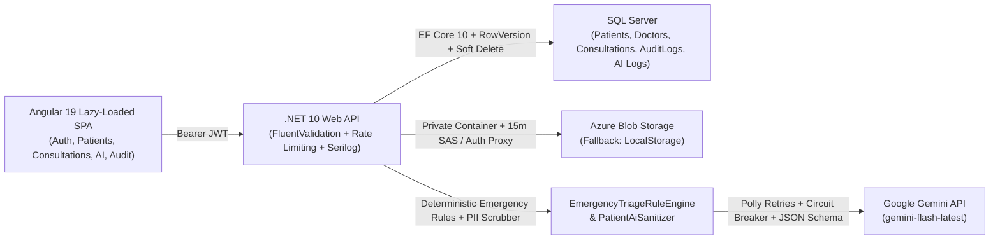

# CareSync — Patient Consultations & Clinical AI Platform

A security-hardened **.NET 10** + **Angular 19** healthcare consultation platform combining Role-Based Access Control (JWT / Azure Entra ID), private Azure Blob Storage, conflict-checked physician scheduling, full audit logging, and a clinical **Google Gemini AI Agent** with rule-based emergency triage and human-in-the-loop action confirmation.

---

## Key Architecture & Security Highlights



### 1. Security & Privacy
- **JWT + Optional Azure AD / Entra ID Authentication:** Roles (`Admin`, `Doctor`, `Receptionist`). Physicians are strictly scoped to their assigned patients (`PrimaryDoctorId`).
- **Server-Side AI Key Management:** No `apiKey` fields exist in API DTOs or browser requests. `Gemini:ApiKey` is loaded exclusively from environment variables or Azure Key Vault.
- **Private Profile Photos:** Containers use `PublicAccessType.None`; clients receive short-lived 15-minute Read SAS URIs (or authenticated `/api/patients/{id}/picture` streaming fallback). Strict 2 MB upload limit and file magic-byte verification (JPEG/PNG/WebP).
- **Safe Onboarding Notifications:** Welcome emails deliver single-use hashed set-password links (`/set-password?token=...`) and never transmit plaintext passwords.
- **Soft Delete & Audit Trail:** Deletions set `IsDeleted`, `DeletedAtUtc`, and `DeletedByUserId` while preserving clinical history. `ApplicationDbContext` records entity mutations to `AuditLogs`. See [COMPLIANCE.md](COMPLIANCE.md) for DPDP Act (2023), HIPAA, and Google Gemini API data-use guidance.
- **Production Controls:** Startup auto-migrations are disabled in production (migrations are packaged separately as idempotent SQL in CI); rate limiting (`auth`, `ai`, and global policies), strict CORS allowlists, and FluentValidation filter active.

### 2. Clinical AI Safety & Quality (`gemini-flash-latest`)
- **Deterministic Emergency Triage (`EmergencyTriageRuleEngine`):** Cardiac chest pain, stroke FAST signs, airway/anaphylaxis, psychiatric crisis, and hemorrhage short-circuit before any LLM invocation to issue immediate emergency instructions (`911` / `112` / `108` / `988`).
- **Prompt Injection Defense & PII Minimization (`PatientAiSanitizer`):** User-written notes/symptoms are delimited inside `<untrusted_clinical_text>` tags; names, emails, phone numbers, and addresses are stripped before calling Gemini; tools execute inside C# authorization checks.
- **Human-in-the-Loop Confirmation:** Scheduling via `propose_consultation` creates a `PendingAiActions` proposal (`Book Dr. Sarah Jenkins...`) requiring an explicit click to `POST /api/ai/actions/{actionId}/confirm`.
- **Structured Output, Citations, Streaming & Simulated Banner:** Enforces Gemini `responseSchema`, returns consultation `#ID` citations, streams responses over SSE (`/api/ai/chat/stream`) with server-side `AiChatSessions`, logs all runs to `AiInteractionLogs`, and displays an explicit **SIMULATED MODE ACTIVE** banner when running without a live server key.

### 3. Resilience & Scheduling Reliability
- **Polly Standard Resilience:** `AddStandardResilienceHandler` wraps outbound Gemini calls with exponential backoff retries, timeouts, and circuit breaking.
- **Double-Booking Prevention & Concurrency:** `DoctorsController` exposes slot availability (`/api/doctors/{id}/availability`) and prevents overlapping slots with HTTP `409 Conflict`. `Patient` and `Consultation` carry `[Timestamp] byte[] RowVersion` tokens returning `409 Conflict` on stale updates.
- **Observability:** Serilog structured logging (with optional Application Insights sink) and `/health` + `/health/ready` database health checks.

---

## Project Structure

```text
├── src/
│   ├── PatientManagement.Core/            # Entities, Enums, Domain Exceptions, DTOs, Interfaces
│   ├── PatientManagement.Infrastructure/  # EF Core 10, Migrations, Auth, AI Safety, Blob & Email Services
│   └── PatientManagement.Api/             # .NET 10 Controllers, JWT/CORS/RateLimit Middleware, Health Checks
├── tests/
│   └── PatientManagement.Tests/           # 54 xUnit Tests (Unit, Integration, RBAC, Concurrency, Mocked AI & 28-Case Eval Suite)
├── frontend/                              # Angular 19 Standalone SPA (Lazy-Loaded Features + Karma Specs)
├── .github/workflows/azure-deploy.yml     # CI/CD: .NET Test+Coverage, EF Script, Angular Lint/Test/Build
├── COMPLIANCE.md                          # DPDP Act, HIPAA & AI Data Governance Guide
├── LICENSE                                # MIT License
└── PatientManagement.slnx                 # .NET Solution File
```

---

## Getting Started (Local Development)

### Prerequisites
- [.NET 10 SDK](https://dotnet.microsoft.com/download/dotnet/10.0)
- [Node.js 20+ / 22+](https://nodejs.org/)
- SQL Server (or LocalDB)

### 1. Run the Backend API
Configure your connection string and optional Gemini key via User Secrets or `src/PatientManagement.Api/appsettings.Development.json`:

```bash
cd src/PatientManagement.Api
dotnet user-secrets set "Gemini:ApiKey" "YOUR_SERVER_SIDE_GEMINI_KEY"
dotnet run
```

- API / Swagger UI: `http://localhost:5056`
- Health endpoint: `http://localhost:5056/health`

### 2. Run the Angular 19 Frontend
```bash
cd frontend
npm install
npm start
```

- Angular Dev UI: `http://localhost:4200` (configured with `proxy.conf.json` -> `http://localhost:5056`)

### Development Seed Accounts

| Role | Email | Password | Permissions |
| :--- | :--- | :--- | :--- |
| **Admin** | `admin@patientportal.com` | `Admin@12345` | Full access including Audit & AI Interaction Logs |
| **Doctor** | `sarah.jenkins@patientportal.com` | `Doctor@12345` | Own assigned patients, consultations & AI Assistant |
| **Doctor** | `robert.sterling@patientportal.com` | `Doctor@12345` | Own assigned patients, consultations & AI Assistant |
| **Receptionist** | `reception@patientportal.com` | `Reception@12345` | Registration, scheduling & onboarding email logs (no AI/delete) |

---

## Testing & Verification

### Backend (.NET 10 — 54 Automated Tests)
Includes unit tests, InMemory API integration tests (`WebApplicationFactory<Program>`), RBAC scoping checks (`401`/`403`), concurrency & double-booking (`409`), upload magic-byte rejection (`400`), mocked HTTP Gemini tool-calling tests, and a **28-case offline AI evaluation dataset** (`tests/PatientManagement.Tests/Evaluation/ai-evaluation-dataset.json`):

```bash
dotnet test PatientManagement.slnx --collect:"XPlat Code Coverage"
```

### Frontend (Angular 19)
```bash
cd frontend
npm run lint
npm test
npm run build
```

---

## Repository Metadata Suggestions (GitHub)
- **Suggested Description:** `Full-stack .NET 10 + Angular 19 Clinical AI Consultation Platform with JWT RBAC, Private Blob SAS, Soft-Delete Audit Trail, Double-Booking Prevention, and Rule-Safe Gemini AI`
- **Suggested Topics:** `dotnet-10`, `angular-19`, `gemini-ai`, `healthcare`, `jwt-authentication`, `rbac`, `entity-framework-core`, `clean-architecture`, `polly`, `azure-blob-storage`

## License
Released under the [MIT License](LICENSE).
